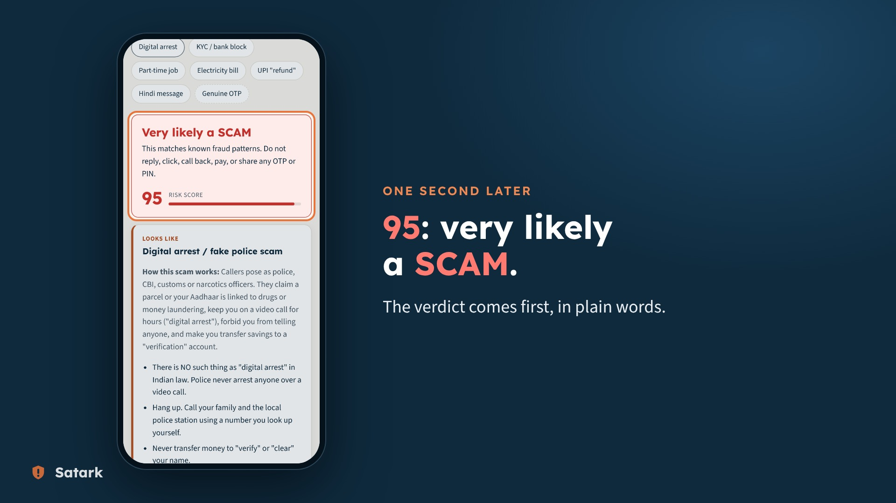
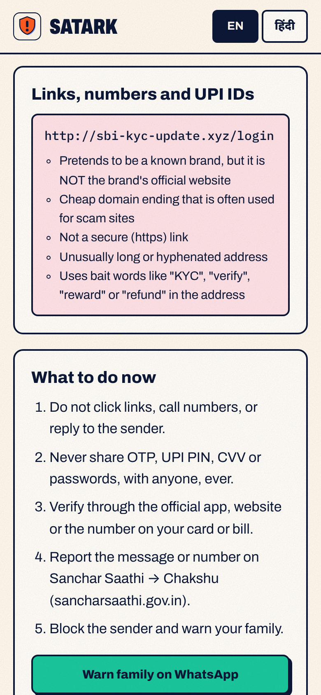
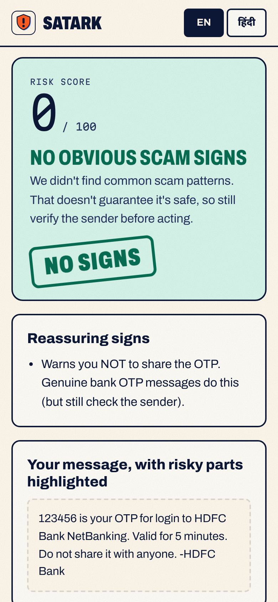

<p align="center"><a href="docs/media/satark-demo.mp4"></a></p>

<h1 align="center">Satark: is this message a scam?</h1>

<p align="center"><b>Paste a suspicious SMS, WhatsApp message or link. Satark tells you whether it is a scam, which kind, why, and what to do next, in English or Hindi. It runs entirely on your phone; nothing you paste is uploaded.</b></p>

<p align="center">
<a href="https://ankur17nith.github.io/satark/"><b>Live app</b></a> ·
<a href="docs/media/satark-demo.mp4">Demo video (2:38)</a> ·
<a href="JUDGES.md">3-minute judge guide</a> ·
<a href="docs/DETECTION.md">How detection works</a> ·
<a href="evidence/eval.json">Evaluation results</a>
</p>

<p align="center">
<a href="https://github.com/Ankur17nith/satark/actions/workflows/ci.yml"></a>
<a href="https://github.com/Ankur17nith/satark/actions/workflows/pages.yml"></a>
<a href="evidence/tests.json"></a>
<a href="https://ankur17nith.github.io/satark/"></a>
<a href="LICENSE"></a>
</p>

Built for **Orbix 2026**, the 48-hour global open-innovation hackathon by Makers Need More (MnM).

## Contents

[At a glance](#at-a-glance) · [The problem](#the-problem) · [What it does](#what-it-does) · [See it](#see-it) · [How it works](#how-it-works) · [Results](#results) · [Tests and reliability](#tests-and-reliability) · [What didn't work](#what-didnt-work) · [Honest scope](#honest-scope) · [Run it](#run-it) · [Repository map](#repository-map) · [Technology and licences](#technology-and-licences)

## At a glance

| What | Result | Evidence |
|---|---|---|
| Scam messages flagged | 30 of 30 rated at least "Suspicious"; 19 of 30 rated "Very likely a SCAM" | [`eval.json`](evidence/eval.json) |
| Genuine messages wrongly flagged | 0 of 30 rated "Very likely a SCAM"; 3 of 30 rated "Suspicious" | [`eval.json`](evidence/eval.json) |
| Scam type named correctly | 15 of the 19 high-risk results | [`eval.json`](evidence/eval.json) |
| Tests | 13 of 13 passing: detection, link analysis, negation, false-positive checks, WCAG AA colour contrast | [`tests.json`](evidence/tests.json) |
| Data sent off the device | None. No server, account or analytics; the only external request is Google Fonts. | [`docs/PRIVACY.md`](docs/PRIVACY.md) |
| Running cost | ₹0: a static site on GitHub Pages, no APIs | [`docs/DEPLOYMENT.md`](docs/DEPLOYMENT.md) |

The evaluation set is 60 messages (30 scams across 10 scam types, 30 genuine) written after the rules were built. The rules were not changed after seeing the results. It is small and written by the author, not an independent dataset; see [Honest scope](#honest-scope).

## The problem

- **Losses are large and rising.** ₹22,845 crore was lost to cyber fraud in India in 2024, up from ₹7,465 crore in 2023, across 36.37 lakh complaints.<sup>[1](#sources)</sup>
- **One scam stands out.** "Digital arrest" cases grew from 39,925 (₹91 crore) in 2022 to 1,23,672 (₹1,935 crore) in 2024.<sup>[1](#sources)</sup> Callers pose as police or CBI, keep the victim on a video call, and forbid them to tell anyone.
- **The scams rely on pressure, not technology.** Fear (arrest, blocked account), deadlines, impersonated authorities, unrealistic rewards and isolation push people to act before checking.
- **Help is missing at the moment it matters.** Awareness campaigns describe scams in general. Most checkers look up a URL or number, work only in English, or upload the message to a server.

## What it does

- **Verdict and score (0–100):** "No obvious scam signs", "Suspicious" or "Very likely a SCAM".
- **Names the scam** from 10 families common in India (digital arrest, fake KYC, task jobs, fake investment, lottery, UPI "wrong transfer", electricity cut-off, fake delivery, loan apps, family impersonation), with how it works and what to do.
- **Highlights the phrases** that raised the score, each with a plain reason.
- **Checks links, phone numbers and UPI IDs:** look-alike bank domains, shorteners, IP addresses, punycode, `.apk` downloads, fake government sites, foreign numbers. Official domains of 27 commonly impersonated brands are recognised.
- **English and Hindi:** reads English, Hindi and Hinglish wording; the whole interface and every explanation switch language.
- **Next steps:** a WhatsApp warning for family, a complaint draft for cybercrime.gov.in, the 1930 helpline and Sanchar Saathi (Chakshu).
- **Installable and offline:** a PWA; on Android, share a message from WhatsApp or SMS straight into Satark.
- **Printed design:** warm paper, ink and three spot colours, condensed poster type, a stamped verdict and drifting cut-paper waves. WCAG AA contrast is tested, and every animation stops under reduced motion. See [`docs/DESIGN.md`](docs/DESIGN.md).

## See it

Open the [live app](https://ankur17nith.github.io/satark/) and tap any example, or watch the [demo video](docs/media/satark-demo.mp4).

<p align="center">
  
  
  
</p>

## How it works

```text
message ─► 19 weighted red-flag signals (English, Hindi, Hinglish) ──┐
        ─► links, phone numbers, UPI IDs (11 link checks) ───────────┼─► score = 100·(1 − e^(−Σ/45)) ─► verdict, scam type,
        ─► 5 combination rules (e.g. authority + threat) ────────────┘                                  highlights, next steps
```

Detection is rule-based so that every point of the score can be shown to the user as a highlighted phrase. Negation is handled: "do not share your OTP" counts as a reassuring sign. Every signal, weight and link check is listed in [`docs/DETECTION.md`](docs/DETECTION.md); the module layout is in [`docs/ARCHITECTURE.md`](docs/ARCHITECTURE.md); design choices are in [`docs/decisions.md`](docs/decisions.md).

## Results

From [`evidence/eval.json`](evidence/eval.json), regenerated with `npm run evidence`:

| Set | Very likely a SCAM | Suspicious | No obvious signs |
|---|---|---|---|
| 30 scam messages | 19 | 11 | 0 |
| 30 genuine messages | 0 | 3 | 27 |

- Every scam was flagged at some level. The 11 rated only "Suspicious" carried one or two signals each (for example a task-job offer with "earn ₹3000 daily" and a Telegram link but no explicit request for money).
- The 3 genuine messages rated "Suspicious" were a bank debit alert ("If not done by you, call…"), "Hi mom, reached the hostel safely" (matches the family-impersonation opener), and a complaint-ID SMS ("within 48 hours").
- Where the scam type was wrong (4 of 19), Satark showed no type rather than a wrong one.

## Tests and reliability

| Check | Result | Evidence |
|---|---|---|
| Unit tests (`node:test`) | 13 of 13 pass: every sample classified, ordinary messages not flagged, negation, curly apostrophes, URL checks, highlight segmentation, score bounds | [`tests.json`](evidence/tests.json) |
| Colour contrast | Every text/background pair in use meets WCAG AA (4.5:1; 3:1 for the large orange headline), checked from `styles.css` | [`tests/contrast.test.js`](tests/contrast.test.js) |
| Published numbers | CI regenerates `evidence/` and fails if the committed numbers are out of date | [`.github/workflows/ci.yml`](.github/workflows/ci.yml) |
| Deploys | GitHub Pages deploys only after the tests pass | [`.github/workflows/pages.yml`](.github/workflows/pages.yml) |
| Untrusted input | Pasted or shared text is rendered with `textContent`, never `innerHTML` | [`docs/ARCHITECTURE.md`](docs/ARCHITECTURE.md#rendering-and-security) |

## What didn't work

- **Only 19 of 30 scams reached "Very likely a SCAM".** Short scams with a single tactic (a task-job offer, a "your loan is approved, pay the fee" message) stay at "Suspicious". That still tells the user to stop and check, but the stronger warning would be better.
- **The "Hi mom" opener causes a false alarm.** A normal family message starting "Hi mom" scores 30 ("Suspicious") because the same opener starts impersonation scams. The rule needs context (a new number plus a money request) rather than the greeting alone.
- **Scam type is sometimes missing.** A SIM-block threat "per TRAI order", an AnyDesk electricity scam, a reward-points phishing link and a Hinglish OTP request were flagged high but not given a type.
- **Not done:** no screenshot (image) checking, no languages beyond English and Hindi, no testing with older users yet.

## Honest scope

| Claim | Real | Simplified or not done |
|---|---|---|
| Detects scams | Measured on 60 labelled messages written after the rules | Small set written by the author; not an independent or real-world sample |
| Hindi support | Hindi and Hinglish patterns, full Hindi interface | Fewer Hindi patterns than English; no native-speaker review yet |
| Private | Analysis runs in the browser; no server exists | Google Fonts are loaded from Google on first visit |
| Link checks | 11 checks plus official domains for 27 brands | No live reputation lookup (by design, to stay on-device) |
| Accessibility | WCAG AA contrast tested, keyboard use, reduced motion | No screen-reader user testing yet |

## Run it

No dependencies and no build step. Node.js 20+ for tests, Python 3 for the local server.

```bash
git clone https://github.com/Ankur17nith/satark.git
cd satark
npm start            # http://localhost:5173
npm test             # unit and contrast tests
npm run evidence     # re-runs tests and the evaluation, rewrites evidence/
```

## Repository map

```text
public/              the app, deployed as-is to GitHub Pages
  src/engine.js      scoring, scam-type classification, highlight segments
  src/rules.js       red-flag signals, scam families, official domains
  src/links.js       link, phone-number and UPI-ID checks
  src/i18n.js        all interface text, English and Hindi
  src/share.js       WhatsApp warning and complaint draft
  src/app.js         interface wiring (the only module that touches the DOM)
  sw.js, manifest.webmanifest   offline support, install, share target
tests/               unit and contrast tests
eval/messages.json   labelled evaluation set (fictional messages)
evidence/            generated results: tests.json, eval.json
scripts/evidence.js  produces evidence/
docs/                architecture, detection rules, decisions, deployment, privacy,
                     hackathon submission, demo video and screenshots
.github/             CI, Pages deployment, issue and PR templates
```

## Technology and licences

| Technology | Used for | Licence |
|---|---|---|
| HTML, CSS, JavaScript (ES modules) | the whole app, no framework | n/a |
| Node.js `node:test` | tests and the evaluation script | MIT |
| Lexend, Source Sans 3, Noto Sans Devanagari (Google Fonts) | typography | SIL Open Font License 1.1 |
| GitHub Actions, GitHub Pages | CI and hosting | hosting |

Our code is MIT ([`LICENSE`](LICENSE)). The demo video's music was generated in code for this project.

## Contributing, security, licence

- Report a missed scam or a false alarm with the [scam pattern template](https://github.com/Ankur17nith/satark/issues/new?template=scam_pattern.yml) (remove personal data first). Code contributions: [`CONTRIBUTING.md`](CONTRIBUTING.md).
- Security issues: please report privately, see [`SECURITY.md`](SECURITY.md).
- Changes: [`CHANGELOG.md`](CHANGELOG.md). Conduct: [`CODE_OF_CONDUCT.md`](CODE_OF_CONDUCT.md).

Satark gives guidance, not a guarantee. A low score does not prove a message is safe. **If you have lost money, call 1930 immediately** or report at [cybercrime.gov.in](https://cybercrime.gov.in/).

## Author

[Ankur17nith](https://github.com/Ankur17nith). MIT licensed.

<sub id="sources">[1] Ministry of Home Affairs reply in Parliament, March 2025 (I4C, NCRP and CFCFRMS data). Digital-arrest figures: NCRP, calendar year 2024.</sub>
