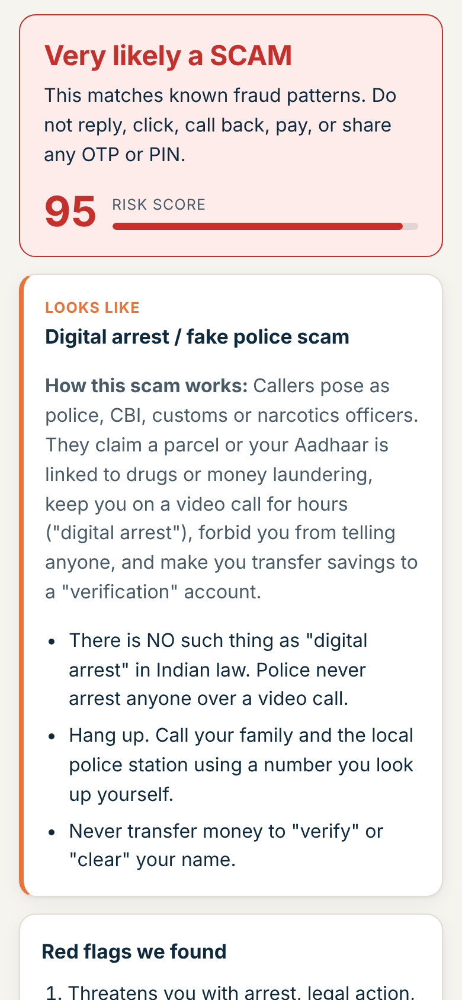
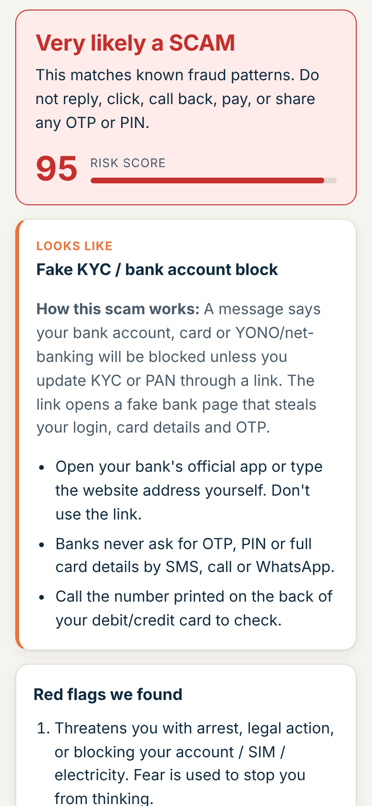
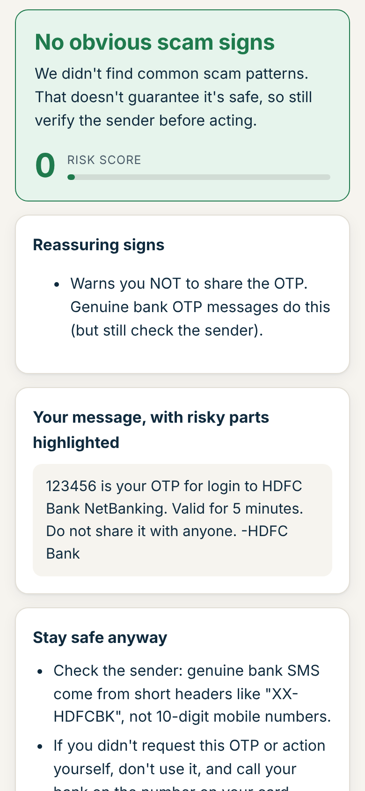

# Satark: Is this message a scam?

**Paste any suspicious SMS, WhatsApp message or link. In under a second, Satark tells you whether it's a scam, what kind, why, and exactly what to do next, in English or Hindi.**

> Indians lost **₹22,845 crore** to cyber fraud in 2024, 3× more than in 2023 (36 lakh+ complaints). "Digital arrest" scams alone took **₹1,935 crore**. *Source: MHA reply in Parliament, 2025 (I4C / NCRP data).*

Most victims aren't careless. They're scared, rushed, or simply never told what a scam looks like. Satark is the friend who reads the message with you and says *"stop, this is the digital-arrest scam, police never do this, call 1930."*

<p align="center">
  
  
  
</p>

## What it does

| | |
|---|---|
| 🎯 **Risk score + verdict** | 0–100 score: *No obvious signs* / *Suspicious* / *Very likely a SCAM* |
| 🧭 **Names the scam** | Digital arrest, fake KYC/bank block, part-time task job, fake investment, lottery, UPI "wrong transfer", electricity disconnection, fake delivery, loan app, family impersonation, each explained in plain language |
| 🚩 **Explains every red flag** | Highlights the exact phrases ("do not tell anyone", "enter UPI PIN to receive") and says *why* each is dangerous |
| 🔗 **Inspects links, numbers, UPI IDs** | Brand look-alike domains (`sbi-kyc-update.xyz`), shorteners, IP links, punycode, `.apk` downloads, fake `gov` sites, foreign numbers, UPI handles; trusts official domains (`onlinesbi.sbi`, `*.gov.in`) |
| 🇮🇳 **English + हिंदी** | Detects Hindi, Hinglish and English scam language; the entire UI and every explanation are bilingual |
| 🆘 **Act immediately** | One tap to warn family on WhatsApp, copy a ready complaint draft for **cybercrime.gov.in / 1930**, report to **Sanchar Saathi (Chakshu)** |
| 🔒 **100% private** | Runs entirely in the browser. No server, no API, no account. Nothing you paste ever leaves your phone |
| 📲 **Installable + share-to-app** | PWA that works offline; on Android, *Share → Satark* straight from WhatsApp/SMS |

## Try it

Open the app and tap any example chip: *Digital arrest*, *KYC / bank block*, *Part-time job*, *Electricity bill*, *UPI "refund"*, *Hindi message*, or *Genuine OTP* (which correctly scores 0).

## How it works

```
message ──► normalise ──► 19 weighted signal detectors (EN/HI/Hinglish regex)
                     ├──► link / phone / UPI extractor ──► URL risk analyser (11 checks, brand allow-list)
                     └──► combo rules (authority + threat, urgency + OTP request, link + pressure …)
                                   │
                     score = 100·(1 − e^(−Σweights/45))  ──►  level + scam-type classifier
                                   │
                     highlighted segments + bilingual explanations + action plan
```

- **Explainable by design:** every point of the score traces to a highlighted phrase and a plain-language reason. No black box.
- **Avoids false alarms:** it understands negation ("do **not** share your OTP" is a *reassuring* sign, not a red flag) and tests check that everyday messages aren't flagged.
- **Zero dependencies:** plain ES modules, no build step, no API keys, and it loads instantly on cheap phones.

```
index.html, styles.css      UI (mobile-first, light/dark, accessible)
src/engine.js               scoring, classification, highlight segmentation
src/rules.js                signals, scam families, brand ↔ official domains
src/links.js                URL / phone / UPI extraction and analysis
src/i18n.js                 English + Hindi copy, scam explainers, advice
src/share.js                WhatsApp warning + complaint draft
sw.js, manifest.webmanifest offline support, install, share target
tests/engine.test.js        11 test groups (node:test)
```

## Run locally

```bash
python3 -m http.server 5173
```

Then open http://localhost:5173. Run the tests with:

```bash
npm test
```

## Deploy (free, ~1 minute)

It's a static site, so any static host works:

- **GitHub Pages:** Settings → Pages → Deploy from branch → `main` / root.
- **Netlify / Vercel / Cloudflare Pages:** import the repo, no build command, output directory `.`.

## Roadmap

- 📸 Screenshot check (on-device OCR) for scams received as images
- 🎙️ Call-script check: paste or speak what a caller said
- 🌐 More languages: Tamil, Telugu, Bengali, Marathi
- 👨‍👩‍👧 "Family guardian" mode: elderly users forward messages to a trusted contact automatically
- 📊 Anonymous, opt-in scam trend map to warn communities about new waves early

## Disclaimer

Satark gives guidance, not a guarantee. A low score does not prove a message is safe. If you've lost money, call **1930** immediately or report at **cybercrime.gov.in**.

## Team

| Member | Role |
|---|---|
| _Name_ | _e.g. detection engine & rules_ |
| _Name_ | _e.g. UI/UX, Hindi localisation_ |
| _Name_ | _e.g. research, testing, pitch_ |

MIT License
